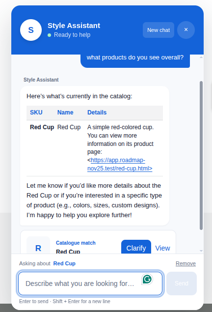

# AI-powered Customization Requests for Magento 2

A storefront chat assistant for Magento 2, that answers product questions from a
vector index of the catalog. When a shopper asks for a change to a product
("I'd take these boots, but in green"), it turns that into a customization
request for an admin to review.



## How it works

1. The chat widget (Luma, RequireJS + LESS) is shown on every storefront page of a store view where
   the module is enabled and talks to Magento over GraphQL.
2. Each message runs through an agent loop on OpenRouter. The model can use three tools:
   - `search_catalog`: hybrid kNN + BM25 search in OpenSearch (reciprocal rank fusion), with a logged
     DB fallback
   - `get_product_context`: details for a single storefront-available SKU
   - `save_customization_request`: creates the session's pending request, or updates it if one exists
3. A new request shows up in the admin notification inbox and under
   **Content → Customization Requests**.
4. When an admin approves a request, the module creates a hidden simple product
   (`<base-sku>-CUSTOM-<id>`) and emails the customer a single-use restore link
   (valid for the configured number of days). If the email fails, the admin can resend it with a new link.
5. The restore link (`/ai-customization/restore/index/token/<token>/`) opens a small page that adds the
   custom product to the visitor's own cart and redirects to the cart page.
6. When an admin declines a request, the customer gets an email with the reason (the note is required).

The agent never quotes prices and never promises approval. Every request goes
through an admin. The customer email comes only from the chat session: the account email for
logged-in shoppers, or the email a guest enters in the widget before the first message.

## Requirements

- Magento 2.4.x with GraphQL modules enabled
- OpenSearch with the k-NN plugin. It can be the same cluster as catalog search.
- An OpenRouter API key, used for both chat and embeddings

## Install

```bash
bin/magento module:enable Perspective_AiCustomizationRequests
bin/magento setup:upgrade
bin/magento indexer:reindex perspective_ai_product_rag
```

## Configuration

Go to **Stores → Configuration → General → Perspective AI Customization**.

| Group | Notes |
|---|---|
| General | Master switch. Off by default. |
| Widget content / welcome / states / appearance | Every label and prompt, plus the colours and an optional logo. Empty fields use the defaults from `config.xml`. |
| OpenRouter | API key (stored encrypted), plus the optional site URL and title sent as attribution headers |
| Agent | Chat model (`openrouter/auto`), embedding model (`google/gemini-embedding-001`), max tool iterations, HTTP timeout, message length limit, session TTL |
| OpenSearch | Host, port and credentials. Leave them empty to reuse the catalog search connection. Also: index name prefix, vector dimensions (`3072`, must match the embedding model), batch size. |
| Email | Sender identity, approve / decline templates, restore link lifetime in days |

You can't change the vector dimensions without a full reindex.

## Indexing

The `perspective_ai_product_rag` indexer maintains one alias per store view, named
`<index_name>_store_<id>`. A full reindex builds a new timestamped index, swaps the alias and drops
the old indices, so search keeps working during the rebuild. Only enabled products that are
visible on the storefront and assigned to the store's website get indexed. Each document holds the
name, descriptions, category names, and readable select/text attributes, and is embedded through
OpenRouter in batches; unchanged documents reuse their stored embedding (content hash).

"Update by schedule" is supported through mview subscriptions on the product
EAV, website, and category-link tables. Large catalogs should use scheduled mode.

## GraphQL API

| Operation | Purpose |
|---|---|
| `mutation startAiChatSession` | Creates a session and returns `session_uid` and a one-time `resume_token` |
| `query resumeAiChatSession(input)` | Loads the history of an existing session |
| `mutation sendAiChatMessage(input)` | Runs one chat turn. Accepts an optional `selected_product_sku`, `current_page_url` and `guest_email`. |
| `mutation restoreAiPreparedCart(token)` | Adds the approved product to the current cart |

The schema is in `etc/schema.graphqls`. Guests have to give an email before
their first message (`email_required`). The resume token is stored only as a sha256 hash.
`sendAiChatMessage` is idempotent by `client_message_id`: the widget retries a failed message with
the same id and gets the stored reply if the turn already ran. Expired sessions are removed by cron.

## Admin

- **ACL:** `requests` (view), `approve`, `decline`, `notify` (resend customer email), `config`
- The grid is a standard UI listing with status filter and row actions. The request page shows the
  requested changes, links to the customer and products, the approve/decline form, the resend
  action, and the history.
- Decisions are compare-and-set status transitions: two admins deciding at once cannot both win.

## Data

| Table | Contents |
|---|---|
| `perspective_ai_chat_session` | Sessions, scoped by store and owner |
| `perspective_ai_chat_message` | Messages, product mentions, and the resolved page context |
| `perspective_ai_customization_request` | Requests, their status, the custom product, and restore token state |
| `perspective_ai_request_history` | Audit trail of submit, approve and decline |

## Code map

See `ARCHITECTURE.md` for responsibilities and rules.

```
GraphQl/                 thin resolvers, RequestScope, ChatOutputFormatter
Model/Chat/              sessions, messages, identity, ChatTurnService
Model/Agent/             agent loop, prompts, transcript replay, tool registry, tools
Model/Request/           requests, status machine, approval, custom product, cart restore, notifiers
Model/Catalog/           storefront product guard, summaries, page context
Model/Search/            OpenSearch client, index manager, document builder, retriever
Model/Indexer/           RAG indexer
Model/OpenRouter/        chat + embeddings client
Model/Infra/             JSON HTTP client, JSON codec, tokens
Model/Config/            typed config access
ViewModel/               widget init, restore page init, admin request view
view/frontend/web/js/    support-chat.js (controller), chat-view.js, chat-markdown.js,
                         chat-service.js (GraphQL), restore-cart.js
```

To add a tool, implement `Model\Agent\Tool\ToolInterface` and register it in
the `tools` argument of `Model\Agent\ToolRegistry` in `etc/di.xml`.
